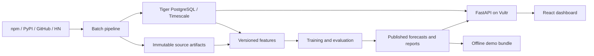

# SignalShift — Detailed Implementation Plan

> Historical implementation record. See the [current overview](../../../index.md) for setup and runtime instructions.


## 1. Purpose and decisions

Build an evidence-based application that helps a startup scout choose **five company-backed AI developer tools to investigate**.

The application will forecast package-download activity, explain the observations behind each forecast, and show whether its recommendations outperform simple historical baselines.

The user’s priorities are:

- Strong scouting evidence and research quality.
- No deadline-driven reduction in quality.
- Multiple implementation agents working through bounded tasks.
- Tiger Data and Vultr as the intended infrastructure.
- Existing credits and free quotas only.
- Honest results, including negative or inconclusive findings.

Downloads remain a measure of package-download activity. They do not establish customer growth, revenue, production adoption, investment returns, or company quality.

### 1.1 Decisions replacing the handoffs

| Question | Final decision |
|---|---|
| Product audience | Startup scouts investigating company-backed AI developer tools. |
| Prediction unit | A verified package associated with a tool; company ownership is a separate relationship. |
| Primary horizon | Total downloads during the next 30 days. |
| Medium-term horizon | Separately evaluated trailing-28-day downloads 91 days ahead. |
| Ecosystems | Support npm and PyPI independently, with separate datasets, models, rankings, and evaluations. |
| First complete implementation | npm, because its public historical download API provides a path without BigQuery credentials. |
| Research expansion | PyPI, once access, extraction feasibility, and credit controls pass. |
| Default ranking | Predicted percentage growth within the selected ecosystem, with one entry per organization. |
| Research budget | Five organizations per shortlist. |
| Historical demonstration | Explicitly labelled reconstructed backtest unless forecasts were actually recorded before outcomes occurred. |
| Statistical baseline | Persistence, weekday seasonal estimates, recent growth, and damped trend. |
| Initial learned models | Ridge and CatBoost; complexity must earn its place through evaluation. |
| Breakout probabilities | Deferred until a separate experiment demonstrates useful, calibrated decision value. |
| Numerical forecasting | Conventional statistical/ML pipeline only. |
| Explanations | Deterministic evidence summaries first; Gemini after numerical and evidence integrity gates. |
| Storage | Normalized Tiger Data PostgreSQL/Timescale, plus immutable artifact files. |
| Deployment | Vultr, subject to verified credits and an explicit resource lifetime. |
| Local fallback | Full application using local Timescale and filesystem artifacts; separate offline replay bundle. |

PyPI is especially useful for research because its release metadata table retains immutable records even for deleted projects and releases. That helps investigate historical cohorts beyond today’s surviving tools. This supports including PyPI; it does not establish that PyPI forecasts will outperform npm forecasts. [PyPI dataset documentation](https://docs.pypi.org/api/bigquery/)

### 1.2 Success criteria

The product is successful when:

1. Every displayed forecast can be traced to verified mappings, source observations, feature definitions, and a model artifact.
2. Historical evaluation respects information availability, label maturity, and chronological model selection.
3. The scout can compare a five-company shortlist against clear alternatives.
4. Model performance, uncertainty, missing coverage, and limitations are visible.
5. The complete application remains usable without live vendor calls during a demonstration.
6. Optional source failures do not corrupt core forecasts.
7. Cloud operation stays within explicitly verified credit constraints.
8. Another engineer can reproduce an experiment from its manifest.

A learned model beating the baseline is a research result to establish, not an assumption required to make the product appear successful.

## 2. Scope and user experience

### 2.1 Included in the main product

- Verified tool, package, repository, and organization catalogue.
- Historical npm and separately gated PyPI download ingestion.
- Weekly forecast origins.
- Next-30-day forecasts and growth rankings.
- Historical reconstruction and prospective forecast records.
- Baseline comparisons and reproducible evaluation.
- Evidence and source-quality panels.
- Manual five-company shortlist selection.
- Historical reveal with forecast and shortlist scoring.
- Deterministic explanations.
- Tiger/Vultr deployment configuration and local operation.
- Operational monitoring, restore procedures, and reproducibility documentation.

### 2.2 Included after explicit evidence gates

- GitHub activity features.
- Hacker News mention features.
- Empirically evaluated prediction intervals.
- The separate 91-day model.
- Gemini explanations.
- Breakout classification and probabilities.

These are sequenced by dependencies and demonstrated value, not by an arbitrary deadline.

### 2.3 Outside the committed product

- Revenue, valuation, funding, or investment-return prediction.
- Predictions of whether a startup will succeed.
- Causal controls such as “increase marketing” or “hire developers.”
- A pooled npm/PyPI download total.
- An unvalidated cross-ecosystem success score.
- Temporal graph neural networks.
- General-purpose conversational agents.
- Wallets, tokens, blockchain attestations, or unrelated sponsor integrations.
- Customer-retention modelling without separately obtained customer-level outcomes.

### 2.4 Application views

**Rankings**

- Select ecosystem, supported forecast target, and cutoff.
- Show organization, tool, selected package, reference downloads, forecast downloads, predicted growth, freshness, and evidence status.
- Display the recommended five-company shortlist.
- Allow the scout to construct an alternative shortlist.
- Show excluded candidates and exclusion reasons.
- Keep baseline rankings accessible.
- Preserve selections in browser storage and shareable URLs keyed to an immutable forecast batch.

**Tool detail**

- Show observed download history through the permitted observation boundary.
- Display forecast-window totals and baseline comparisons.
- Show uncertainty only when its serving gate passes.
- Present dated source observations and original links.
- Explain package-to-tool and tool-to-company mappings.
- Separate measured changes from predictive interpretations.

**Historical replay**

- Select an available historical forecast batch.
- Identify it as reconstructed or prospective.
- Show forecasts and permit shortlist selection before reveal.
- Reveal only mature outcomes.
- Freeze the original shortlist for its score; subsequent edits form a separate selection.
- Show successes, misses, and baseline comparisons.
- Preserve the forecast payload unchanged after reveal.

**Evaluation**

- Compare model families and source ablations.
- Show exact periods, candidate counts, organization counts, missingness, and exclusions.
- Distinguish descriptive evidence from stronger statistical claims.
- Include negative and inconclusive results.
- Link to downloadable experiment manifests and reports.

**Data health**

- Show source freshness, missing partitions, revisions, mapping status, and connector failures.
- Keep engineering details here and in provenance drawers, rather than crowding the main scouting flow.

### 2.5 Chart semantics

The initial models predict aggregate windows, not daily trajectories.

- For the 30-day target, show the forecast as a total for the highlighted future window.
- For the 91-day target, show the forecast as the trailing-28-day value at its target date.
- Show uncertainty around that aggregate estimate.
- Do not interpolate an aggregate prediction into an invented daily curve.
- Keep observed and forecast values visually distinguishable without relying solely on color.
- Support keyboard navigation, accessible tables, reduced motion, and narrow screens.

## 3. Exact prediction and temporal contracts

### 3.1 Shared time definitions

All timestamps are timezone-aware UTC.

Let:

- `t = decision_at`: Monday at 00:00 UTC.
- `a = observation_window_end`: `t − 48 hours`.
- Every measurement window is half-open: `[start, end)`.
- The initial availability policy uses the same fixed anchor across tools.

The two-day lag provides a consistent reference boundary. It is an engineering assumption for historical reconstruction, not proof that the vendor published every observation within two days.

For prospective forecasts, observations must also have been collected by `t`. Faster publication does not silently move the reference window; slower publication causes explicit missingness.

This corrects the handoffs’ assumption that a Monday-midnight forecast can use finalized Sunday totals. npm documents processing after UTC midnight and notes that the latest available day can lag. [npm download API](https://github.com/npm/registry/blob/main/docs/download-counts.md)

### 3.2 Targets

| Target identifier | Reference total | Future outcome |
|---|---|---|
| `downloads_next_30d_v1` | `B30 = sum(downloads in [a−30d, a))` | `Y30 = sum(downloads in [t, t+30d))` |
| `downloads_trailing_28d_at_91d_v1` | `B28 = sum(downloads in [a−28d, a))` | `Y91 = sum(downloads in [t+63d, t+91d))` |

The ecosystem is a separate required identifier. Each `(ecosystem, target_id)` has its own model, calibration, and evaluation.

Growth is:

```text
predicted_growth_pct = 100 × (predicted_downloads / reference_downloads − 1)
```

Only expose percentage-growth ranking when the reference count is at least 1,000.

Below that threshold:

- Display eligible count forecasts.
- Set percentage-growth ranking eligibility to false.
- Explain that the denominator is too small for the chosen ranking policy.

Label the reference window with its dates. Do not call this adjacent-month growth, because the reference and target windows have a two-day gap.

### 3.3 Worked boundary example

For `decision_at = 2025-01-06T00:00:00Z`:

- Observation window ends at `2025-01-04T00:00:00Z`.
- Thirty-day reference: `[2024-12-05, 2025-01-04)`.
- Primary outcome: `[2025-01-06, 2025-02-05)`.
- Medium-term outcome: `[2025-03-10, 2025-04-07)`.

These dates become saved unit-test fixtures.

### 3.4 Eligibility

| Capability | Initial rule |
|---|---|
| Display observed history | Verified identity mapping and real observations. |
| Produce a learned forecast | At least 84 consecutive complete days ending at `a`; required feature windows valid. |
| Rank by percentage growth | Forecast eligible and reference count at least 1,000. |
| Score a fixed top-five benchmark | At least ten eligible organization representatives at that origin. |
| Reveal outcomes | Entire target window observed and its publication/collection conditions satisfied. |
| Publish validated intervals | Calibration and coverage gates in Section 7 pass. |
| Claim statistical superiority | Additional dependence-aware evidence gate passes. |

These are versioned project rules. They are not universal statistical guarantees.

### 3.5 Historical versus prospective modes

Use two explicit modes:

**`reconstructed`**

- Historical data retrieved later.
- Availability may rely on documented or assumed lag.
- Historical content may have been revised or deleted.
- Historical models are fitted only on then-matured labels within the simulated experiment.
- UI language: “Reconstructed historical backtest.”

**`prospective`**

- Source snapshots were actually collected before the decision cutoff.
- The forecast artifact was committed before its target window began.
- Model, features, mapping version, and evidence are immutable.
- UI language may state that the forecast was recorded before the outcome.

A job running late cannot create a prospective forecast retroactively. It must mark the origin missed or produce a separately labelled reconstruction.

## 4. Catalogue and data acquisition

### 4.1 Catalogue structure

Maintain separate entities for:

- Organization.
- Tool/product.
- Package.
- Repository.
- Mapping evidence.
- Effective-dated associations.

Required identity rules:

- One primary package per tool per ecosystem.
- One designated representative tool/package per organization per ecosystem for the company shortlist.
- Select primary packages from official installation guidance, not whichever package later grows fastest.
- Retain additional packages as research metadata without summing them into an adoption total.
- Use stable repository IDs alongside repository names.
- Record package migrations, ownership changes, renames, and discontinuation.
- Do not silently splice renamed or replacement packages into a continuous series.

PyPI package names must follow canonical normalization, including collapsing runs of hyphens, underscores, and periods. Lowercasing alone is insufficient. [PyPA name normalization](https://packaging.python.org/en/latest/specifications/name-normalization/)

### 4.2 Cohort construction

Use two separately labelled cohorts:

1. **Contemporary catalogue reconstruction:** the verified current product catalogue evaluated historically.
2. **Historical eligibility cohort:** membership supported by dated evidence available at each historical origin.

The first is useful but subject to survivorship and selection bias. The second supports stronger discovery claims.

Acquisition targets:

- Initial integration: ten diverse, verified npm tools.
- Initial scouting catalogue: at least 20 distinct organizations.
- Broader research target: approximately 150 PyPI tools and 75 npm tools, where valid candidates exist.
- These counts are acquisition goals, not permission to include weak mappings.

Cover multiple categories:

- Model-provider SDKs.
- Orchestration and agents.
- Evaluation and observability.
- Retrieval and vector infrastructure.
- Data ingestion and extraction.
- Developer execution infrastructure.

Separate company-backed products from community projects and established reference platforms. Community projects may support research without appearing as startup candidates.

For every candidate, record:

- Inclusion/exclusion reason.
- Official installation and repository evidence.
- Evidence dates.
- Package and repository identifiers.
- Organization relationship.
- Category and its evidence basis.
- Mapping reviewer and version.
- Earliest defensible eligibility date.

Freeze cohort rules before inspecting held-out growth outcomes. Preserve inactive and unsuccessful tools when they historically qualified.

### 4.3 Shared ingestion behavior

Every source adapter must:

1. Accept explicit date bounds and catalogue version.
2. Use bounded concurrency.
3. Apply timeouts, bounded retries, and `Retry-After`.
4. Save the raw response or extraction artifact with a checksum.
5. Validate schema and identity.
6. Preserve explicit zero separately from missing records.
7. Record coverage and provenance.
8. Resume from durable checkpoints.
9. Produce idempotent normalized observations.
10. Publish nothing until required validation succeeds.

Initial HTTP defaults:

- At most four concurrent requests per source.
- Three total attempts for retryable transport/429/5xx failures.
- Exponential backoff with jitter.
- Response-size and timeout limits.
- No retries for malformed identities or definitive validation errors.

Provider-specific documented limits override these defaults.

### 4.4 npm

Use daily range counts:

- Request one package at a time.
- Use explicit UTC dates.
- Split history into 365-day chunks.
- Convert inclusive API bounds into internal half-open windows.
- Handle scoped package names correctly.
- Preserve returned zero-count days.
- Treat absent days as missing.
- Store current metadata separately from historical observations.

The documented 18-month limit is a maximum request span, not a statement that older history is unavailable. Scoped packages also have bulk-query restrictions. [npm range and bulk-query documentation](https://github.com/npm/registry/blob/main/docs/download-counts.md)

Begin by testing available history back to 2022-01-01 for the verified cohort. Report actual coverage rather than assuming all tools existed then.

Refresh the most recent 14 days daily to detect revisions. Recheck a longer recent window weekly. Any changed observation creates a new revision and dataset version.

### 4.5 PyPI

Prerequisites:

- Google project and BigQuery API access.
- Dataset location and current schema inspection.
- Confirmed quota/credit eligibility.
- Query dry-run estimates.
- Per-query and cumulative budget controls.

Extraction rules:

- Use `bigquery-public-data.pypi.file_downloads`.
- Query bounded timestamp partitions.
- Extract all selected packages together for each bounded period.
- Select only necessary columns.
- Apply one versioned distribution-file filter across the entire history.
- Retain `.whl`, `.tar.gz`, and `.zip` requests consistently.
- Exclude the known `bandersnatch` installer under a documented filter version; retain unknown installers.
- Never describe this as removing all bots or CI traffic.
- Record query text, parameters, job ID, scanned bytes, and billed bytes.

PyPI changed download logging on 24 August 2026. Applying the same distribution filter on both sides avoids learning the resulting definition change as package decline. [PyPI logging-change announcement](https://blog.pypi.org/posts/2026-08-31-download-counts/)

A package predicate or SQL `LIMIT` does not establish a low scan cost. Use partition bounds, dry runs, and `maximum_bytes_billed`. [BigQuery cost controls](https://docs.cloud.google.com/bigquery/docs/best-practices-costs)

If credits cannot support adequate history, retain the connector and feasibility report, mark PyPI blocked, and continue the complete npm product. Do not substitute short-history statistics while claiming the planned long-history evaluation.

### 4.6 GitHub

Use GH Archive for historical event extraction, subject to coverage audits. Avoid downloading the global archive locally when a bounded filtered extraction is available. [GH Archive](https://www.gharchive.org/)

Initial candidate features:

- Push-event count.
- Pull requests opened.
- Issue events.
- Release events.
- Distinct observed actors.

Controls:

- Deduplicate event IDs.
- Resolve repository renames through stable IDs.
- Audit event-type coverage by month.
- Distinguish transport success from upstream capture completeness.
- Version parsers across schema changes.
- Do not convert missing fields into zeros.
- Do not use present-day stars as historical features.

GitHub changed event payloads in October 2025, including removal of push commit summaries/counts. Historical feature definitions must survive that change or explicitly split regimes. [GitHub event-payload change](https://github.blog/changelog/2025-08-08-upcoming-changes-to-github-events-api-payloads/)

Exclude star features initially. GH Archive’s issue tracker reports substantial WatchEvent capture degradation; this is a reported coverage problem requiring investigation, not a reliable popularity signal. [GH Archive coverage report](https://github.com/igrigorik/gharchive.org/issues/320)

### 4.7 Hacker News

Use dated search with:

- Exact official domains and repository/package identifiers.
- Reviewed aliases and exclusion rules.
- Separate story and comment counts.
- Item-ID deduplication.
- Query manifests and matching-rule versions.
- Recursive date subdivision when retrieval is truncated.

The project’s issue tracker documents queries limited to 1,000 retrievable hits. Pagination alone therefore does not establish completeness. [HN search retrieval-limit report](https://github.com/algolia/hn-search/issues/230)

Do not use current scores or comment totals as historical snapshots. Edited/deleted content remains a limitation of reconstructed matching.

If matching confidence or retrieval completeness is inadequate, show HN as unavailable or experimental. Do not convert an unsuccessful search into zero discussion.

### 4.8 Coverage model

Record separate dimensions:

- Request/extraction success.
- Expected-day or partition completeness.
- Upstream capture confidence.
- Entity-match confidence.
- Freshness.
- Availability basis.

A successful HTTP response is not equivalent to a complete historical source.

## 5. Storage, provenance, and publication

### 5.1 Authoritative stores

Use:

- **Tiger PostgreSQL/Timescale:** normalized identities, observations, revisions, run metadata, forecast records, and relationships.
- **Immutable artifact storage:** raw source responses, Parquet datasets, feature matrices, models, evaluation reports, and demo exports.
- **Local equivalent:** the same database schema with filesystem artifacts.

Use Polars for dataframe operations and Parquet processing. Do not add a second analytical database unless profiling identifies a concrete need.

Wide feature matrices are versioned analytical artifacts, not a replacement for normalized transactional records.

### 5.2 Principal relational entities

| Entity group | Records |
|---|---|
| Identity | `organization`, `tool`, `package`, `repository` |
| Mapping | Effective-dated organization/tool/package/repository relationships and evidence |
| Sources | `source`, `metric_definition`, `source_series`, `ingestion_run`, `source_coverage` |
| Observations | Append-only `observation_revision` records |
| Datasets | `dataset_version`, artifact manifests, selected revision references |
| Features | Feature-schema metadata and feature-artifact references |
| Models | `experiment`, `model_run`, `calibration_run`, model/calibrator pair |
| Forecasts | `forecast_batch`, `forecast_result`, interval records |
| Evidence | `evidence_item`, forecast-to-evidence relationships |
| Evaluation | `evaluation_run`, metric definitions, metric values, cohort counts |
| Operations | Job state, watermarks, leases, budget reservations |

Types:

- Download and event counts: `BIGINT`.
- UTC instants: `TIMESTAMPTZ`.
- Calendar dates: `DATE`.
- Rates, forecasts, and scores: finite double precision.
- Flat lists where appropriate: native arrays.
- Related entities: child/association tables.
- Raw external JSON: immutable artifact files, not JSON strings in text columns.

### 5.3 Observation provenance

Every observation revision includes:

- Series/entity identifier.
- Measurement interval.
- Value and completeness status.
- Vendor publication time, when available.
- First observed/collected time.
- Retrieval time.
- Availability basis and policy version.
- Raw artifact hash.
- Extraction ID.
- Transformation/filter version.
- Revision identifier.

For historical assumptions, do not populate a fabricated vendor publication timestamp. Store the assumed availability bound separately.

### 5.4 Timescale use

Use a time-partitioned observation table with indexes for series, date, and revision selection.

Any unique hypertable key must include its time partition column. [Timescale unique-index requirements](https://www.tigerdata.com/docs/build/performance-optimization/hypertables-and-unique-indexes)

Start chart aggregation with indexed queries and ordinary views. Add continuous aggregates only after profiling demonstrates value and their freshness semantics are tested.

Continuous aggregates must never become the authoritative source for frozen replay. Historical backfills can require explicit refresh even when real-time aggregation is enabled. [Timescale aggregate freshness](https://www.tigerdata.com/docs/learn/continuous-aggregates/real-time-aggregates)

### 5.5 Immutable dataset publication

Use this sequence:

1. Write content-addressed artifacts.
2. Verify checksums and read-back.
3. Validate schemas, coverage, mappings, and temporal rules.
4. Commit dataset metadata and artifact references in a database transaction.
5. Atomically advance the published dataset pointer.

A database transaction cannot atomically commit an external object upload. This sequence prevents publication of references to absent artifacts.

Interrupted publication leaves the previous dataset active. Unreferenced uploads are recorded for later maintenance.

Each dataset manifest binds:

- Catalogue and mapping version.
- Selected observation revisions.
- Source extraction manifests.
- Filters and availability policy.
- Feature and target definitions.
- Code revision.
- Configuration hash.
- Artifact checksums.
- Known limitations.

### 5.6 Forecast immutability

A forecast references a fixed:

- Dataset.
- Feature row.
- Model/calibrator pair.
- Target definition.
- Evidence bundle.
- Decision cutoff.

Later source corrections, mapping changes, and model retraining create new versions. They never rewrite a published forecast.

Prospective scoring retains both:

- The first complete outcome vintage.
- Any later corrected outcome vintage.

Reports identify which outcome vintage they use.

## 6. Features and numerical models

### 6.1 Feature construction

Build one row per:

```text
(tool_id, ecosystem, target_id, decision_at, dataset_version)
```

Initial features:

- Download totals over 7, 28, 30, 56, 60, and 84 available days.
- Log-transformed reference activity.
- Growth between adjacent nonoverlapping 28-day and 30-day windows.
- Dispersion of weekly log changes.
- Weekday share.
- Verified package age.
- Annual sine/cosine seasonality.
- Observation freshness and coverage.

With 84 days, there are twelve weekly totals and eleven adjacent differences. Name the dispersion feature accordingly; do not claim twelve changes without additional history.

Later features:

- Audited GitHub activity.
- Disambiguated HN mention counts.
- Explicit source-availability masks.

Do not include tool IDs, organization IDs, current funding, current stars, or current company descriptions as predictors in the initial models.

### 6.2 Transformation efficiency

- Use lazy Polars scans, projection pushdown, and vectorized window operations.
- Compute rolling totals once per series.
- Avoid rescanning full history for every cutoff.
- Materialize only selected feature columns.
- Convert to NumPy at the estimator boundary.
- Bound ingestion concurrency and model thread counts.
- Keep dataframe previews to at most ten rows.

### 6.3 Prediction formulation

For outcome `Y` and reference `B`, model:

```text
r = log1p(Y) − log1p(B)

prediction = max(0, expm1(log1p(B) + predicted_r))
```

This makes persistence equivalent to zero predicted log growth.

Train pooled models per ecosystem and target, rather than a separate high-variance model for each tool.

### 6.4 Predeclared experimental ladder

| Model | Definition |
|---|---|
| Persistence | Forecast equals reference downloads. |
| Weekday seasonal baseline | Average each weekday over the last four available weeks, apply those weekday means to target dates, and sum. |
| Damped trend | Adjacent reference-window log growth, clipped to ±`log(2)`, damped by 0.5, and scaled by the distance between reference and target midpoints. |
| Ridge | Predict log-growth residual; training-only scaling and imputation; alpha in `{0.1, 1, 10, 100}`. |
| CatBoost | CPU quantile model for 0.1, 0.5, and 0.9; depth `{4, 6}`, L2 `{3, 10}`, learning rate 0.05, up to 1,000 iterations. |

Use chronological validation and 50-round early stopping during development. Freeze the selected iteration count before final fitting and evaluation.

Equalize total training weight per weekly origin so periods with more eligible tools do not automatically dominate.

A log-RMSE estimate is not automatically a median after inverse transformation. Only identify a forecast as a median when its objective supports that interpretation. CatBoost provides explicit quantile objectives. [CatBoost regression objectives](https://catboost.ai/docs/en/concepts/loss-functions-regression)

### 6.5 Model selection

Development selects:

- Strongest simple forecast baseline.
- Strongest simple ranking baseline.
- Learned challenger.
- Feature set.
- Hyperparameters.
- Release gates.

Primary selection criterion: mean realized log growth of the top-five shortlist.

Guardrail: macro log-download MAE must be no more than 2% worse than the strongest simple forecast baseline.

Require positive decision gain in at least two of the three development validation blocks. Among qualifying learned models, choose the highest mean decision score; break close ties in favor of the simpler model.

Freeze the fallback before opening the final holdout.

### 6.6 Additional-source experiments

Evaluate:

1. Downloads only.
2. Downloads plus GitHub.
3. Downloads plus HN.
4. Downloads plus both.

Compare on identical eligible rows and candidate sets.

Also report operational coverage and abstention rates. A source that improves a small complete-case subset may still reduce product usefulness if it excludes most candidates.

Promote a source only when:

- Temporal and coverage audits pass.
- Development improvement is reproducible.
- Forecast guardrails pass.
- Final evaluation supports the preregistered release rule.
- Collection cost fits verified credits.
- Failure behavior is defined.

## 7. Evaluation, uncertainty, and ranking

### 7.1 Calendar-based splits

Do not split the panel by arbitrary row positions. All tools at one origin belong to the same temporal block. Generic `TimeSeriesSplit` defines its gap in samples, which does not directly represent a changing tool-week panel. [scikit-learn time-series splitting](https://scikit-learn.org/stable/modules/generated/sklearn.model_selection.TimeSeriesSplit.html)

Construct the initial full evaluation backwards:

1. Let `M` be the latest Monday with fully mature target outcomes under the dataset’s availability policy.
2. Final test contains 26 consecutive origins from `M−25 weeks` through `M`.
3. Let `T` be the first test origin.
4. Find the latest calibration origin whose labels are available by `T`.
5. Calibration contains that origin and the preceding 25 weekly origins.
6. Let `C` be the first calibration origin.
7. Find the latest development-validation origin whose labels are available by `C`.
8. Use the preceding 39 origins as three consecutive 13-origin validation blocks.
9. At each validation start, train only on labels available by that start.
10. Require at least 52 earlier eligible training origins and the necessary 84-day feature lookback.

These origin counts do not equal the required calendar history: label-maturity gaps and feature lookback extend it.

If history is insufficient:

- Produce a clearly labelled exploratory evaluation.
- Report the actual periods and limitations.
- Start or continue prospective collection.
- Do not silently shorten the protocol while retaining a full-validation claim.

### 7.2 Final model/calibrator pairing

For the primary frozen-model evaluation:

- Select the recipe using development only.
- Fit the final model on labels available by `C`.
- Keep that model frozen while generating calibration predictions.
- Fit calibration using outcomes available by `T`.
- Keep both model and calibrator frozen throughout the final test.

Refitting the model on calibration labels while retaining its previous calibration correction is prohibited.

Weekly-refit deployment simulation is a separate experiment with separate results. Its recipe must be fixed before evaluation, and every refit uses only then-matured labels.

### 7.3 Prediction intervals

For quantile models, use chronological conformalized quantile calibration on log-target scale:

```text
score = max(q10 − observed_log_target,
            observed_log_target − q90,
            0)
```

Use the calibration score order statistic at:

```text
ceil(0.8 × (n + 1))
```

Widen the predicted interval by that amount, then inverse-transform and clip at zero.

Sort crossing quantile estimates before calibration and report the crossing rate.

Return:

- `interval_lower`
- `interval_upper`
- `nominal_coverage`
- `interval_method`
- `calibration_id`

Do not rename adjusted interval endpoints “calibrated p10/p90.”

Time dependence and drift prevent an automatic distribution-free guarantee. Treat realized coverage as empirical evidence. [Conformalized quantile regression paper](https://papers.neurips.cc/paper_files/paper/2019/hash/5103c3584b063c431bd1268e9b5e76fb-Abstract.html)

Initial serving gates:

- At least 500 calibration predictions.
- At least 26 calibration origins and 30 distinct organizations.
- Final overall empirical coverage between 75% and 90% for the nominal 80% interval.
- No sufficiently supported major subgroup below 70% coverage.
- Interval score competitive with a calibrated baseline.

A sufficiently supported subgroup means at least 100 rows spanning at least 13 origins.

If a gate fails, retain experimental interval results in Evaluation but omit the validated band from the main forecast display.

### 7.4 Ranking policy

Within one ecosystem and target:

- Rank eligible organization representatives by predicted percentage growth.
- Break UI ties by stable tool ID.
- Show `min(5, eligible_count)` selections.
- Explain any shortlist shortfall.
- Do not give an organization multiple slots through multiple packages.

Compare against:

- Recent observed growth.
- Damped-trend growth.
- Current download popularity.
- Uniform random selection.

Persistence predicts zero growth for every tool, so it is not a meaningful unique growth ranking. Evaluate its tied ranking using random/tie-averaged selection rather than treating alphabetical ordering as a serious comparator.

### 7.5 Evaluation metrics

**Primary scouting metric**

- Mean realized log growth of the selected five, averaged by origin.

**Decision diagnostics**

- Difference against each baseline shortlist.
- Regret against the ex-post best five.
- Precision@5 for a predeclared 50% growth event.
- Recall@5.
- Spearman rank correlation.
- Selection stability.
- Eligibility and abstention rates.

**Forecast diagnostics**

- Macro MAE on `log1p(downloads)`.
- Raw-count MAE by download-size band.
- Error by category, age, ecosystem, and source coverage.
- Quantile pinball loss.
- Interval coverage, width, and interval score.

Edge cases:

- No breakout positives: precision is zero; recall is null.
- Constant ranks: undefined correlation is null.
- Fewer than ten eligible organizations: exclude the origin from headline top-five evaluation and report the exclusion.
- Incomplete outcomes: remain missing, never become zero or negative labels.
- Every comparison uses the same candidate universe.

### 7.6 Dependence and strength of claims

Adjacent labels overlap and tools share ecosystem shocks.

For paired comparisons:

- Aggregate differences by origin.
- Resample whole cross-sectional weeks together.
- Use contiguous blocks.
- Initial block length: `max(ceil(horizon_days / 7), 4)` weeks.
- Repeat sensitivity at twice that block length.
- Use 2,000 fixed-seed bootstrap replicates.
- Report effective block counts.

A 26-origin holdout supports descriptive evaluation but provides few long blocks. Require at least eight horizon-length blocks before making a statistical-superiority claim:

- Forty weeks for the 30-day target.
- 104 weeks for the 91-day target.

These are conservative project gates, not mathematical guarantees. Prospective evidence must accumulate with real elapsed time; additional agents cannot accelerate outcome maturity.

Also report:

- Nonoverlapping-origin sensitivity.
- Held-out organization-family results.
- Historical-cohort versus contemporary-catalogue results.
- Availability-lag sensitivity at 24, 48, and 72 hours.

### 7.7 Final-test discipline

The final holdout can confirm or reject the preregistered challenger. It cannot select the best contender after the fact.

On failure:

- Serve the preregistered baseline.
- Publish the failed or inconclusive result.
- Retain the challenger in Evaluation.
- Require new evaluation data for a revised recipe.

Do not repeatedly tune against the same final period.

## 8. Backend, API, and explanation contracts

### 8.1 Execution boundary

The API reads published results.

It does not:

- Train models.
- Fetch vendor data.
- Run paid queries.
- Generate a fresh LLM answer on every browser request.

Batch jobs create datasets, forecasts, explanations, and evaluation artifacts.

### 8.2 API routes

Use `/api/v1`.

| Route | Purpose |
|---|---|
| `GET /health/live` | Process liveness. |
| `GET /health/ready` | Required storage, schema, and artifact readiness. |
| `GET /catalog` | Search and filter verified tools and organizations. |
| `GET /cutoffs` | Available ecosystem/target/cutoff combinations. |
| `GET /tools/{tool_id}/history` | History bounded by the selected forecast batch. |
| `GET /forecasts/{batch_id}` | Immutable forecasts and provenance. |
| `GET /rankings/{batch_id}` | Ranking, eligibility, exclusions, and baseline rankings. |
| `POST /replays/{batch_id}/reveal` | Mature outcomes and scores for submitted shortlist IDs. |
| `GET /evaluations/{evaluation_id}` | Immutable evaluation results. |
| `GET /data-health` | Public source freshness and quality summary. |

Validation:

- Reject unsupported targets and cutoffs.
- Accept only catalogue IDs.
- Validate at most five distinct organizations in a submitted shortlist.
- Return per-tool unavailable states without discarding valid results.
- Use 422 for invalid requests, 404 for unknown resources, and 409 when reveal is not yet allowed.
- Never silently snap a request to another model or cutoff.

### 8.3 Forecast result contract

Each result includes:

| Group | Fields |
|---|---|
| Identity | Forecast, batch, tool, organization, package, ecosystem IDs |
| Time | Decision time, observation-window end, reference start/end, target start/end |
| Definition | Target ID and definition version |
| Prediction | Reference count, predicted count, predicted growth, estimate kind |
| Uncertainty | Nullable interval bounds, nominal coverage, method, calibration ID |
| Baseline | Baseline model ID and predicted count |
| Eligibility | Forecast status, ranking eligibility, reason codes |
| Evidence | Typed observations and evidence IDs |
| Provenance | Dataset, mapping, feature-schema, model, and experiment IDs |
| Evaluation | Evidence status and reconstruction/prospective mode |
| Freshness | Data age and stale-state information |
| Replay | Whether a complete outcome is available |

Use `estimate_kind` to distinguish:

- `conditional_median`
- `log_space_point`
- `baseline`

Keep forecast availability separate from validation status. An experimental forecast may exist without being validated.

Pre-reveal DTOs contain no actual future outcome fields. Reveal uses a separate DTO and only adds truth and scores.

### 8.4 Contract generation

- Define typed Pydantic models as the API source of truth.
- Generate TypeScript types from OpenAPI.
- Check generated-contract drift in CI.
- Maintain clearly labelled synthetic fixtures for component development.
- Use only actual published results in product demo bundles.

### 8.5 Explanations

Start with deterministic templates based on:

- Reference activity.
- Recent measured growth.
- Source changes.
- Forecast/baseline differences.
- Coverage limitations.

Gemini is an optional enhancement after the core works.

Its input is a bounded evidence bundle containing permitted observations, timestamps, source links, and immutable forecast values.

Its output separates:

- Measured changes.
- Cautious predictive interpretations.
- Limitations.
- Evidence IDs.

Controls:

- Disable browsing and external tools for replay explanations.
- Treat source text as untrusted content.
- Validate cited IDs against the supplied bundle.
- Render numerical forecast values directly from application data.
- Reject unsupported citations and malformed output.
- Fall back to deterministic text on any failure.
- Cache by forecast ID, evidence hash, prompt version, and model ID.
- Record the actual configured model identifier.
- Run fidelity checks on a saved adversarial test set.

Structured output assists schema validation but does not replace semantic validation. [Gemini structured-output documentation](https://ai.google.dev/gemini-api/docs/structured-output)

## 9. Repository, dependencies, and development environment

### 9.1 Existing repository corrections

The repository currently contains template code rather than an application.

Required setup changes:

- Keep the existing `oxhack2026` Python package.
- Use SignalShift as the product name and `signalshift` as the CLI entry point.
- Replace placeholder application code and tests as functional modules arrive.
- Add runtime dependencies and a checked-in `uv.lock`.
- Standardize Python support on 3.12 initially.
- Align Docker, devcontainer, tox, package metadata, and Ruff.
- Change Ruff line length from 120 to 88.
- Disable automatic fixes in verification commands.
- Replace template README claims and badges with actual project instructions.
- Add CI; no CI workflow directory was found.
- Repair Docker’s missing-lockfile assumption and system-Python startup.
- Remove emoji from touched development commands to follow repository guidelines.

### 9.2 Dependency groups

| Group | Initial packages |
|---|---|
| Core/data | `polars`, `orjson`, `httpx`, `pydantic`, `pydantic-settings`, `typer` |
| Storage | `sqlalchemy`, `psycopg`, `alembic` |
| API | `fastapi`, `uvicorn` |
| Models | `numpy`, `scikit-learn`, `catboost` |
| BigQuery adapter | `google-cloud-bigquery` |
| Object storage | `boto3` |
| Explanations | `google-genai` |
| Development | Ruff, mypy, pytest, pytest-cov, HTTP mocking, required typing support |
| Frontend | React, TypeScript, Vite, React Router, TanStack Query, Apache ECharts |
| Frontend verification | Vitest, Testing Library, Playwright |

Avoid adding pandas, DuckDB, PyArrow, Redis, Celery, Kubernetes, or a separate experiment-tracking server without a demonstrated requirement.

Use Node 24 LTS for the frontend toolchain and pin a patched release during setup. A security update for that release line was published on 21 October 2026. [Node security release](https://nodejs.org/en/blog/vulnerability/october-2026-security-releases)

Record exact resolved package versions, runtime patches, uv version, and container digests in the implementation. Do not invent those pins in this planning document.

Install `ipykernel` and `ipywidgets` into the developer `.venv` separately, without adding them to project requirements. Document that an exact environment sync may remove these local additions.

### 9.3 Module ownership

Organize the existing package into:

- `catalog`
- `ingest`
- `storage`
- `features`
- `models`
- `evaluation`
- `api`
- `explanations`
- `cli`

Keep frontend, migrations, tests, deployment configuration, and documentation separate.

Shared business logic belongs in package modules. CLI and scheduled jobs call the same functions.

### 9.4 CLI capabilities

Implement commands for:

- Catalogue validation.
- Source extraction.
- Observation validation.
- Dataset publication.
- Feature/label building.
- Experiment execution.
- Forecast publication.
- Outcome scoring.
- Demo export.
- Artifact verification.
- Data-health inspection.

Each command takes explicit version/configuration identifiers and returns a nonzero exit status on failure.

Each stage records inputs, outputs, configuration hash, code revision, timing, and status.

### 9.5 Quality requirements

- Typed public interfaces and complete public docstrings.
- Specific exception handling.
- Structured logging with `logger.error` for errors.
- No secret-bearing URLs or credentials in logs.
- Ruff for formatting, linting, and import ordering.
- mypy without blanket suppression of project errors.
- pytest tests saved as discrete files before execution.
- Mock external services in unit tests.
- Separate explicit integration tests for real local services.
- Retain test output artifacts under an ignored run-specific directory.
- Do not delete test-created artifacts automatically.

## 10. Deployment, costs, and operations

### 10.1 Deployment topology



Production components:

- Vultr VM for reverse proxy, static frontend, and FastAPI.
- Short-lived batch containers invoked by systemd timers.
- Tiger managed PostgreSQL/Timescale.
- Vultr Object Storage when credits support it.
- Isolated CPU/RAM limits for training.
- Local training remains valid when cloud compute credits are unsuitable.

Do not assume Tiger and Vultr share private networking. Use supported nearby regions and verified TLS.

### 10.2 Scheduling

Initial schedule:

- Daily ingestion after the source availability window.
- Daily recent-history revision checks.
- Weekly reference-data reconciliation.
- Weekly forecast origins.
- Outcome scoring after each target matures.
- Model retraining according to the frozen deployment recipe.
- Optional explanation generation after forecast publication.

Use explicit watermarks and bounded catch-up. Duplicate invocations must be safe.

No scheduler runs inside the API process.

### 10.3 Credits-only controls

Maintain separate provider budgets with:

- Account/project identifier.
- Verified remaining credit.
- Eligible products.
- Expiry.
- Currency.
- Current pricing basis.
- Unsettled usage.
- Existing resource commitments.
- Verification timestamp.

Unknown balance, expiry, or eligibility blocks paid execution.

Before a paid operation:

1. Calculate a defensible maximum cost.
2. Reserve it transactionally.
3. Preserve a 20% safety reserve.
4. Submit with a stable job/request identifier.
5. Reconcile actual usage.
6. Retain reservations when submission status is uncertain.

The safety reserve reduces risk; it is not a financial guarantee.

For BigQuery:

- Dry run first.
- Set `maximum_bytes_billed`.
- Respect remaining query quota and provider credit.
- Do not resubmit a timed-out job without checking its ID.

For Gemini:

- Reserve maximum input/output tokens and retry allowance.
- Disable separately billed tools.
- Generate explanations in batches, not from public browser requests.

Billing alerts alone do not cap spending, and even provider spend-cap mechanisms can have delayed enforcement. [Google budget documentation](https://docs.cloud.google.com/billing/docs/how-to/budgets), [spend-cap limitations](https://docs.cloud.google.com/billing/docs/how-to/budgets-spend-caps)

### 10.4 Persistent resource lifetime

Cloud provisioning requires a concrete operating lease and export/cleanup policy.

Reserve costs for:

- Compute.
- Database.
- Object and backup storage.
- Network transfer.
- Retained IPs or other independently billed resources.
- Export and teardown.

Default deployment lease: seven days, renewable only after credit revalidation.

Stopping a Vultr VM must not be treated as ending its charges. The cleanup policy must account for resource destruction and separately billed storage after verified export. [Vultr stopped-instance billing](https://docs.vultr.com/support/platform/billing/are-stopped-instances-still-billed-on-vultr)

If the lease or cleanup policy is not established, complete the local product and leave deployment blocked. Do not present local completion as a deployed sponsor integration.

### 10.5 Security and service boundaries

- Public application is read-only.
- Administrative operations use CLI/CI credentials.
- Separate migration, batch-writer, and API-reader database roles.
- Verify database certificates and hostname.
- Keep database ports private.
- Expose HTTPS and restricted administrative access only.
- Apply request limits and explicit CORS policy.
- Escape external text.
- Restrict connector destinations and redirects.
- Never load model artifacts from untrusted source URLs.
- Verify artifact hash, format, size, and schema before loading.
- Keep secrets in ignored environment configuration or provider-managed secret injection.
- Exclude credentials and signed storage URLs from public manifests.

### 10.6 Deployment and rollback

- Build locked, non-root images.
- Put the virtual environment on the runtime path.
- Deploy the tested image digest.
- Run migrations once through the migration role.
- Prefer additive schema changes.
- Publish model/data manifests independently of application images.
- Switch active release pointers only after readiness checks.
- Roll back application and model pointers independently.
- Avoid automatic destructive database down-migrations.

The uv Docker guidance supports locked layered installs and production virtual-environment setup. [uv Docker integration](https://docs.astral.sh/uv/guides/integration/docker/)

### 10.7 Backups and monitoring

Keep independently restorable copies of:

- Database metadata and forecast ledger.
- Dataset manifests.
- Required raw/processed artifacts.
- Model/calibration pairs.
- Deployment configuration.

Verify actual Tiger backup retention against the account’s tier. A successful restore exercise is required before declaring cloud operation complete.

Initial operational targets:

- Cached ranking/forecast API p95 below 500 ms at 20 concurrent readers.
- Detail-page data load below two seconds.
- No partial dataset publication.
- Last-known-good release remains available after a failed batch.
- Restore target: four hours.
- Maximum operational metadata loss target: 24 hours.

These are targets to test, not claims of achieved performance.

Monitor:

- Mandatory-source freshness.
- Missing partitions and coverage collapse.
- Failed forecast publication.
- Schema changes.
- Artifact checksums.
- Database errors.
- Disk and object-storage failures.
- TLS expiry.
- Credit balance and lease expiry.
- Matured forecast error and interval coverage drift.

Run benchmarks serially.

## 11. Multiagent implementation and dependency order

### 11.1 Ownership

| Workstream | Owns | Depends on |
|---|---|---|
| Integration | Root configuration, contracts, lockfiles, migration ordering, CI, releases | Product decisions |
| Catalogue/data | Identity evidence, source adapters, manifests, source-quality tests | Identity and temporal contracts |
| Storage/backend | Schema, repositories, API, publication | Contracts |
| Features/models | Features, targets, models, calibration, evaluation | Validated dataset interface |
| Frontend | Views, charts, client state, browser tests | OpenAPI and labelled fixtures |
| Infrastructure | Images, local services, cloud configuration, restore/rollback | Runnable services |
| Independent review | Leakage, reproducibility, cost, and failure-mode audits | Deliverables from other streams |

Multiple roles may run sequentially when agent capacity is limited.

### 11.2 Agent protocol

Every task has:

- Task ID.
- Owner.
- Declared writable paths.
- Dependencies.
- Acceptance checks.
- Expected artifacts.
- Handoff status.

Rules:

- One branch/worktree per implementation task.
- One owner for shared API and dataset contracts.
- Integration owner controls root lockfiles.
- Migrations are ordered through integration.
- Agents use mocks and approved snapshots by default.
- Only the designated pipeline runner holds production/billing credentials.
- Shared extraction locks prevent duplicate paid jobs.
- Training uses a resource semaphore.
- Benchmarks use a process-visible serial lock.
- Subagents receive bounded research, implementation, or review tasks.
- Repeated failure on the same cause produces a blocker record after three attempts; independent tasks continue.

Continuous agent operation means repeated bounded work with integration gates. It does not mean unrestricted spending, recursive retries, or simultaneous edits to shared files.

### 11.3 Implementation milestones

| Milestone | Deliverables | Exit gate |
|---|---|---|
| M0 — Foundation | Runtime alignment, dependency locks, CI, contracts, target definitions, credit inventory template | Clean setup and contract checks |
| M1 — Real npm slice | Ten verified mappings, daily history, manifests, database ingestion, history API/chart | Real source-to-chart flow |
| M2 — Frozen datasets | Revision storage, publication, feature/label builders, availability tests | Reproducible snapshot and leakage tests |
| M3 — Forecast research | Baselines, Ridge/CatBoost, calendar splits, evaluation reports | Honest out-of-sample results |
| M4 — Scouting product | Rankings, manual shortlist, detail, replay, evaluation, offline export | Full browser workflow |
| M5 — PyPI expansion | Credit-bounded extraction, normalized distribution counts, separate models/reports | Same integrity gates as npm |
| M6 — Additional signals | GitHub/HN audits and ablations | Demonstrated value or documented exclusion |
| M7 — Uncertainty and medium term | Validated intervals; separate 91-day experiment | Target-specific evidence gates |
| M8 — Sponsor deployment | Tiger/Vultr deployment, cost controls, restore and rollback | Confirmed resources and deployment tests |
| M9 — Explanations | Gemini adapter, fidelity checks, deterministic fallback | Evidence-fidelity gate |
| M10 — Prospective validation | Immutable live predictions, matured scoring, drift review | Accumulating prospective evidence |

Critical path:

```text
Contracts
→ verified identity
→ real observations
→ immutable dataset
→ temporal features/labels
→ baseline evaluation
→ learned-model evaluation
→ published forecasts
→ rankings/replay
→ deployment
```

Parallel work after contract freeze:

- Frontend against synthetic fixtures.
- Storage migrations and API repositories.
- Source adapters.
- Feature/model modules against saved test fixtures.
- CI and container setup.
- Independent temporal-integrity tests.

Do not wait for optional GitHub, HN, Gemini, or cloud deployment to complete the real npm path.

## 12. Verification and acceptance

### 12.1 Data and identity tests

- Duplicate canonical package names rejected.
- Scoped npm names encoded correctly.
- Unverified mappings excluded.
- Repository rename preserves stable identity.
- Primary package changes create explicit mapping versions.
- Inactive tools remain in historical cohorts.
- Explicit zero remains zero.
- Missing day remains missing.
- Negative counts rejected.
- Incomplete extracts cannot publish complete datasets.
- Reingestion is idempotent.
- Revised observations preserve old dataset versions.
- PyPI filter remains identical across the logging transition.
- HN truncation triggers subdivision or partial status.
- GitHub schema changes preserve unsupported fields as missing.

### 12.2 Temporal and modelling tests

- Half-open boundaries match the worked examples.
- Monday/UTC validation is exact.
- Fixed observation anchor is respected.
- Future-available records cannot change past features.
- Prospective mode requires actual collection before cutoff.
- Immature labels are excluded.
- Training labels must be available at fit time.
- Preprocessing is fitted only on training rows.
- All tools at an origin share its split.
- Organization families stay together in held-out-group evaluation.
- Calibration remains paired with its frozen model.
- Quantile transformations and ordering are correct.
- Ranking thresholds and tie handling are deterministic.
- Every model comparison uses identical candidates.
- Aggregate models never serialize invented daily forecasts.
- Reproduction from manifests yields identical split membership and metrics within declared numerical tolerance.

### 12.3 API and frontend tests

- OpenAPI and generated TypeScript agree.
- Partial per-tool availability is supported.
- Invalid cutoff/target requests fail clearly.
- No future outcomes appear in pre-reveal responses.
- Reveal adds truth without changing predictions.
- Unmatured reveal returns 409.
- Missing values do not render as zero.
- Experimental and rejected models display honestly.
- Baseline identity remains visible.
- Shortlist duplicates by organization are rejected.
- Replay selections remain frozen for scoring.
- Keyboard and reduced-motion paths work.
- Offline bundle uses the same contracts and UI components.

### 12.4 Operational tests

- Interrupted object/database publication leaves the prior release usable.
- Missing or corrupted artifacts fail before model loading.
- Schema mismatch fails readiness.
- Concurrent budget reservations cannot overspend the local allowance.
- Unknown or stale credits block paid operations.
- Submission timeout does not duplicate a paid query.
- Optional source outage preserves the valid core path.
- Missing cloud credentials still permit local completion.
- All vendor and Gemini network access can be disabled during demo replay.
- Database restore and application/model rollback succeed.
- Lease expiry follows the documented export/cleanup procedure.
- Test artifacts remain available for inspection.

### 12.5 Verification commands

After the implementation exists and dependencies are locked:

```bash
uv run --frozen ruff check --no-fix .
uv run --frozen ruff format --check .
uv run --frozen mypy oxhack2026 tests
uv run --frozen pytest
```

Frontend checks:

```bash
npm ci
npm run typecheck
npm run test
npm run build
npm run test:e2e
```

Also require:

- Generated-contract drift check.
- Migration checks.
- Container build.
- Manifest/artifact verification.
- Saved end-to-end replay test.
- Serial performance test.

No implementation tests have been run as part of this planning phase.

## 13. Completion states and research extensions

### 13.1 Explicit completion states

**`LOCAL_COMPLETE`**

- Real npm data.
- Verified catalogue.
- Versioned datasets.
- Baselines and evaluated learned models.
- Complete FastAPI/React scouting workflow.
- Historical reveal.
- Offline replay.
- Reproducible CLI and passing checks.

**`SECOND_ECOSYSTEM_COMPLETE`**

- PyPI access and cost gates pass.
- Separate PyPI data, models, and evaluations satisfy the same integrity requirements.

**`CLOUD_READY`**

- Tested images, configuration, migrations, estimates, restore procedures, and rollback exist.

**`CLOUD_DEPLOYED`**

- Verified credits and resource lease.
- Actual Tiger/Vultr deployment.
- Successful smoke, outage, restore, and rollback checks.

**`EXPLANATIONS_ENABLED`**

- Gemini access and cost controls pass.
- Evidence-fidelity tests pass.
- Deterministic fallback remains available.

**`PROSPECTIVE_VALIDATION_ACCUMULATING`**

- Forecasts are recorded before outcomes.
- Matured predictions are scored without rewriting their original evidence.

These states prevent an unavailable integration from being reported as complete.

### 13.2 Deliverables

The implementation must produce:

- Final repository-root `PLAN.md`.
- Product README and reproducible setup instructions.
- Catalogue and mapping evidence.
- Source manifests and coverage reports.
- Feature and target dictionaries.
- Database migrations.
- Typed API and generated frontend contracts.
- Baseline and learned-model artifacts.
- Experiment manifests and evaluation reports.
- Frozen replay scenarios, including failures.
- Offline demo bundle.
- Deployment, credit, restore, and rollback documentation.
- Agent ownership and task handoffs.
- A concise model/data limitations statement.

### 13.3 Deferred research

Only start these after a named experiment and acceptance criterion are defined:

- Breakout probabilities with sufficient positive/negative examples and chronological calibration.
- Historical dependency graphs.
- Dated discussion embeddings.
- Learned ranking models.
- Validated cross-ecosystem shortlist policies.
- Consented true-usage or retention outcomes.
- ElevenLabs narration of an existing evidence briefing.

Snowflake, Solana, and Presage have no necessary role in the committed design. HRT is addressed through measurable prediction and decision evaluation; sponsor eligibility must be checked against actual event rules rather than assumed from integration names.

The central delivery remains a reproducible scouting system whose recommendations, uncertainty, and limitations can be inspected against real outcomes.
